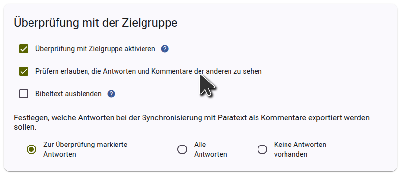
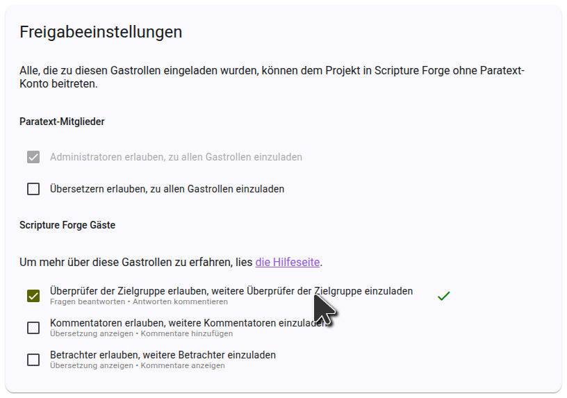
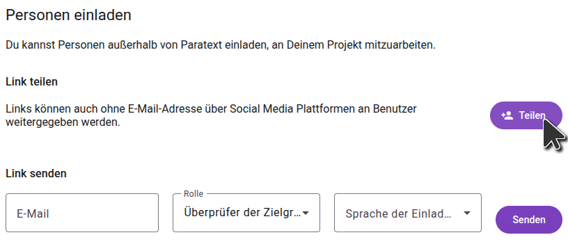

import ReactPlayer from "react-player";

## Leute einladen, Dein Projekt zu überprüfen {#1850d745ac9e80caacf5e643bb216f77}

<ReactPlayer controls url="https://youtu.be/aBPHCF56hxA" />

Sobald Du die Fragen zu Deinem Projekt hast, wird es Zeit, Überprüfer aus der Zielgruppe einzuladen.

Klicke in der Seitenleiste auf **Einstellungen** und scrolle nach unten zu **Freigabeeinstellungen**.

### Einstellungen Benutzerinteraktion {#1850d745ac9e8018b5a7ff9f3ea349e9}

Die erste Einstellung, die es zu beachten gilt, ist die Einstellung **Prüfern erlauben, die Antworten und Kommentare der anderen zu sehen**. Wenn Überprüfern der Zielgruppe eine Frage angezeigt wird, werden existierende Antworten von anderen Überprüfern der Zielgruppe nicht angezeigt, damit dies die erhaltene Antwort nicht beeinflusst. Sobald eine Frage beantwortet ist, werden alle anderen Antworten auf die Frage angezeigt, und die Überprüfer können die Antworten des anderen kommentieren und gegenseitig Antworten mit "Gefällt mir" markieren. Wenn Du diesen Austausch nicht möchtest, aber möchtest, dass Antworten von anderen Überprüfern immer ausgeblendet werden, deaktiviere **Prüfern erlauben, die Antworten und Kommentare der anderen zu sehen**.

### Freigabeeinstellungen {#1850d745ac9e8097ad4efcb063fc2603}

Wenn Du möchtest, dass Überprüfer der Zielgruppe Freunde zum Projekt einladen können, achte darauf, dass **Überprüfer der Zielgruppe erlauben, weitere Überprüfer der Zielgruppe einzuladen** aktiviert ist. To let translators send invitations, enable **Allow translators to invite any guest role**. Project admins can always invite community checkers.

### Überprüfer der Zielgruppe einladen {#1850d745ac9e802d84d8e00da4fe25c2}

Klicke in der Seitenleiste auf **Benutzer** und es werden Dir Freigabeoptionen angezeigt.

To invite someone by sending a link, click **Share**, select the **Community Checker** role and the language you want Scripture Forge to show the recipient, then click **Copy link**. Send the link to the person you want to invite so they can join the project as a community checker.

Wenn Du Einladungen per E-Mail an Benutzer senden möchtest, gib die E-Mail-Adresse des Benutzers ein, den Du einladen möchtest, wähle die Rolle **Überprüfer der Zeilgruppe** und die Sprache der Einladung. Klicke dann auf **Senden**. Eine E-Mail mit einem Link wird an die Person gesendet, die dann den Link anklicken und sich anmelden muss, um dem Projekt beizutreten.

