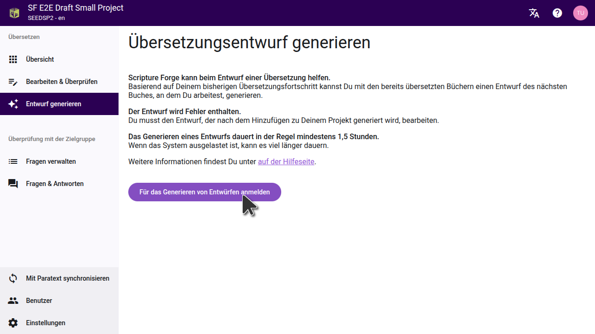
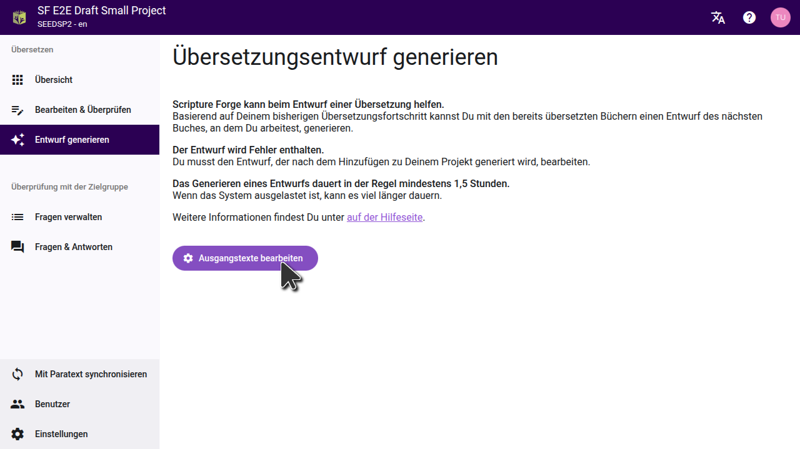
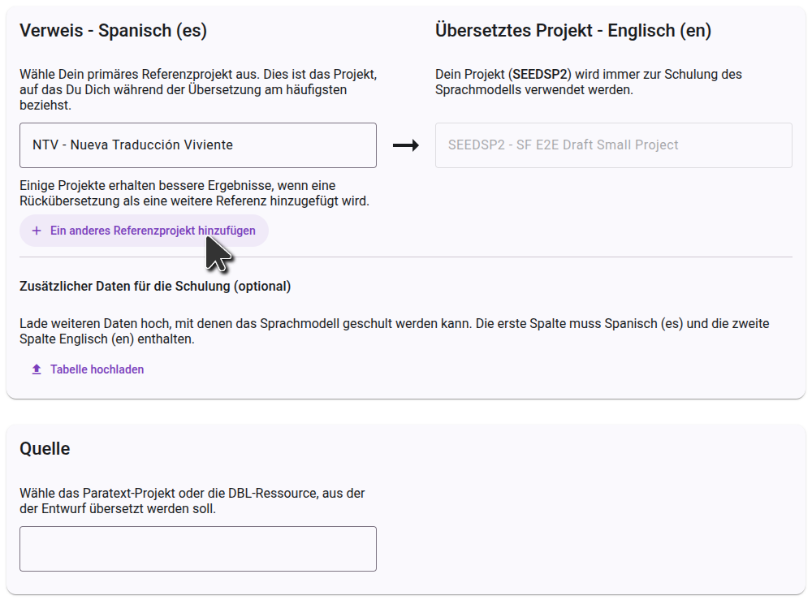
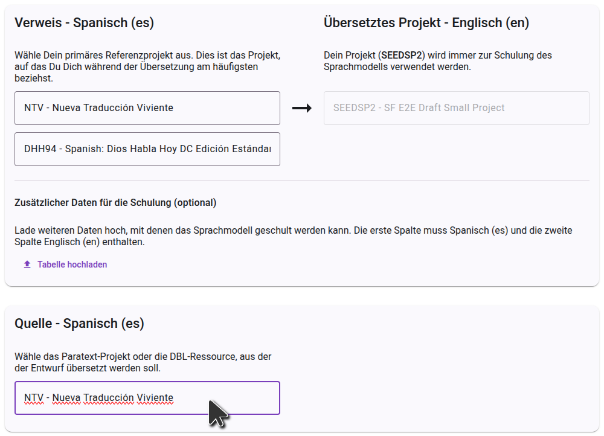
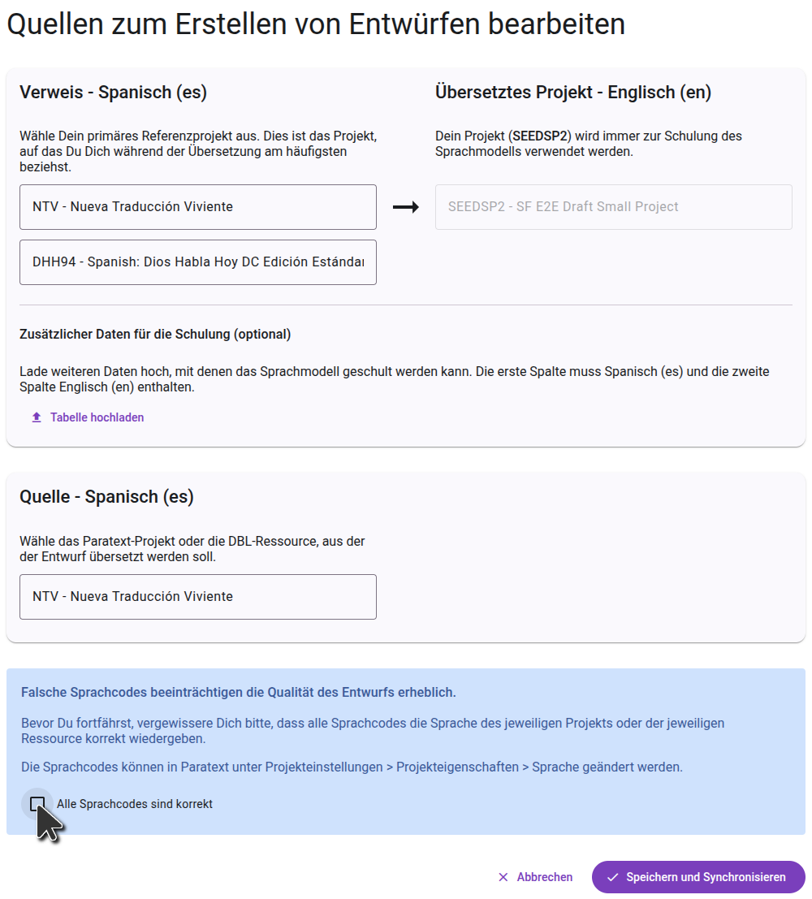

## Registrieren um einen Entwurf zu generieren {#c01e77600a3b440ead3f1b816837d614}

Um einen Entwurf in Scripture Forge zu regeistrieren, klicke auf die Schaltfläche "Entwurf generieren" im Hauptmenu. Klicke dann auf "Für Übersetzungsentwurf generieren anmelden" und fülle das Formular aus, das erscheint, um Deinem Projekt den Zugang zu ermöglichen. Rückübersetzungsprojekte sind standardmäßig aktiviert. Das Formular muss dafür nicht ausgefüllt werden.

:::note

Falls Du ein separates Paratext-Projekt eingerichtet hast, um generierte Entwürfe abzulegen, stelle sicher, dass Du Dich von Deinem Hauptübersetzungsprojekt aus registrierst. Registriere Dich nicht vom Ablageprojekt aus. Entwürfe können in einem anderen Projekt gespeichert werden, aber sie müssen von Deinem Hauptprojekt aus generiert werden, damit das Modell von Deiner vollständigen Übersetzungsarbeit lernen kann.

:::

Nachdem Du das Formular ausgefüllt hast, wird das Scripture Forge Onboarding-Team Deine Anfrage prüfen und die besten Einstellungen für Dein Projekt ermitteln. Du erhältst einen oder mehrere Entwürfe zur Durchsicht. Fall Du Dich dafür entscheidest, dass die Erstellung von Entwürfen für Dein Projekt das Richtige ist, wird das Team das Generieren von Entwürfen für Dein Projekt aktivieren und Dich durch den Prozess der Auswahl der besten Einstellungen führen.

## Konfigurieren des Entwurfs {#26e1244e99c0459bad277d7cff4417b8}

Sobald das Generieren von Entwürfen für Dein Projekt aktiviert ist, wird die Schaltfläche "Für das Generieren von Entwürfen anmelden" durch die Schaltfläche "Ausgangstexte konfigurieren" ersetzt. Klicke auf diese Schaltfläche, um die Projekte auszuwählen, die als Ausgangstext für Deinen Entwurf verwendet werden sollen.

### Auswahl der Referenzprojekte

Das Referenzprojekt wird für die Schulung des Sprachmodells verwendet. Normalerweise ist dies das Projekt, auf das Du Dich während der Übersetzung am häufigsten beziehst, aber in manchen Fällen kannst Du bessere Ergebnisse erzielen, wenn Du ein anderes Projekt verwendest. In einzelnen Projekten ist die Wahl eines zweiten Referenzprojekts möglicherweise sinnvoll. Ein häufiger Anwendungsfall ist es, Deine Rückübersetzung als zweites Referenzprojekt auszuwählen.

Jedes Projekt ist anders. Befolge daher die Anweisungen, die Du vom Onboarding-Team erhalten hast.

### Schuldungsdaten hinzufügen

Scripture Forge nutzt die fertige Übersetzung Deines Projekts, um das Sprachmodell zu schulen. Um weitere Schulungsdaten hinzuzufügen, lade eine Tabelle unter **Zusätzliche Schulungsdaten (optional)** hoch. Füge der ersten Spalte einen Satz aus der Ausgangssprache und dessen Übersetzung in die Sprache Deines Projekts in der zweiten Spalte jeder Zeile hinzu.

### Wähle das Ausgangsprojekt aus

Unter **Quelle**, wähle das Projekt aus, aus dem der Entwurf übersetzt werden soll. Dies kann ein Paratext-Projekt oder eine Ressource der Digitalen Bibelbibliothek sein. Gib den Anfang des Projektnamens (oder den Kurznamen des Projektes) ein und die Liste wird so gefiltert, dass Du nur die passenden Projekte siehst. Klicke auf das Projekt, das Du als Quelle verwenden möchtest.

### Die Sprachen bestätigen

Stelle sicher, dass der für jedes Projekt oder jede Ressource angezeigte Sprachcode mit der Sprache des jeweiligen Textes übereinstimmt. Du kannst den Sprachcode eines Projekts in Paratext unter **Projekteinstellungen > Projekteigenschaften > Sprache** ändern.

Sobald die Codes korrekt sind, setze ein Häkchen bei **Alle Sprachcodes sind korrekt** und klicke auf **Speichern & synchronisieren**. Sobald die Projekte vollständig synchronisiert sind, klicke auf **Schließen**, um zur Seite **Entwurf erstellen** zurückzukehren.

