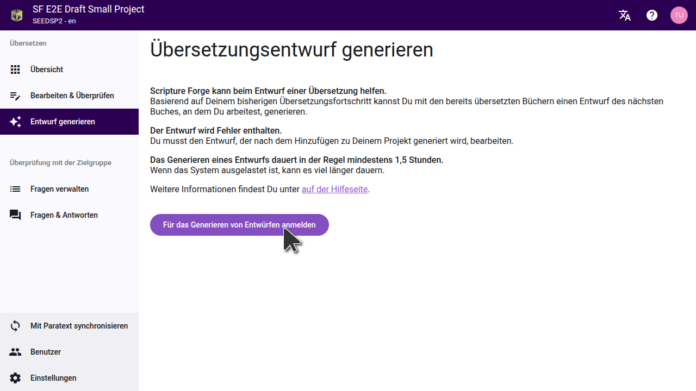
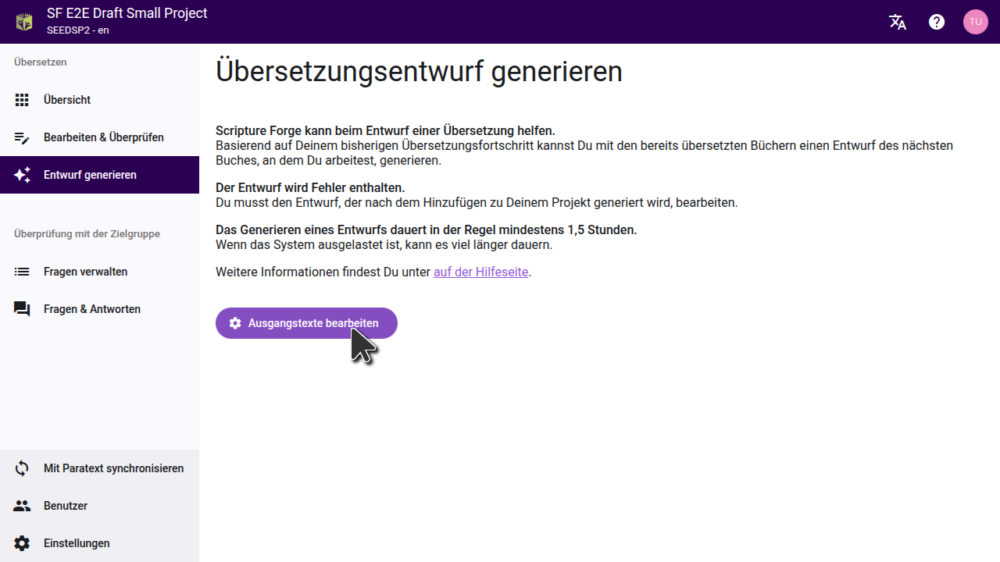
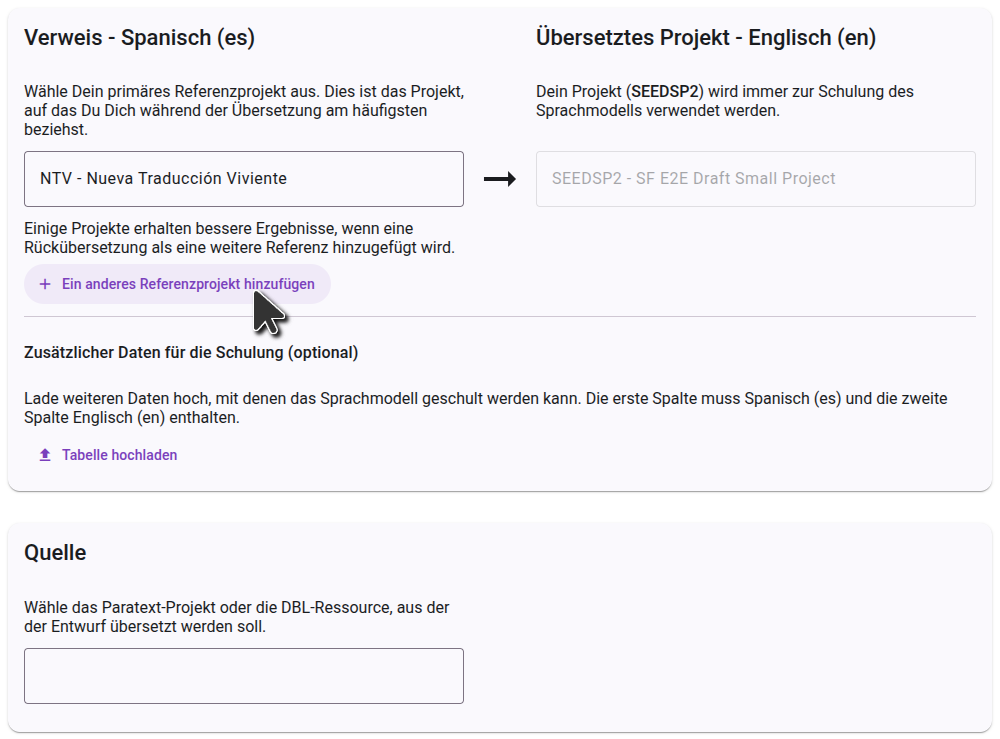
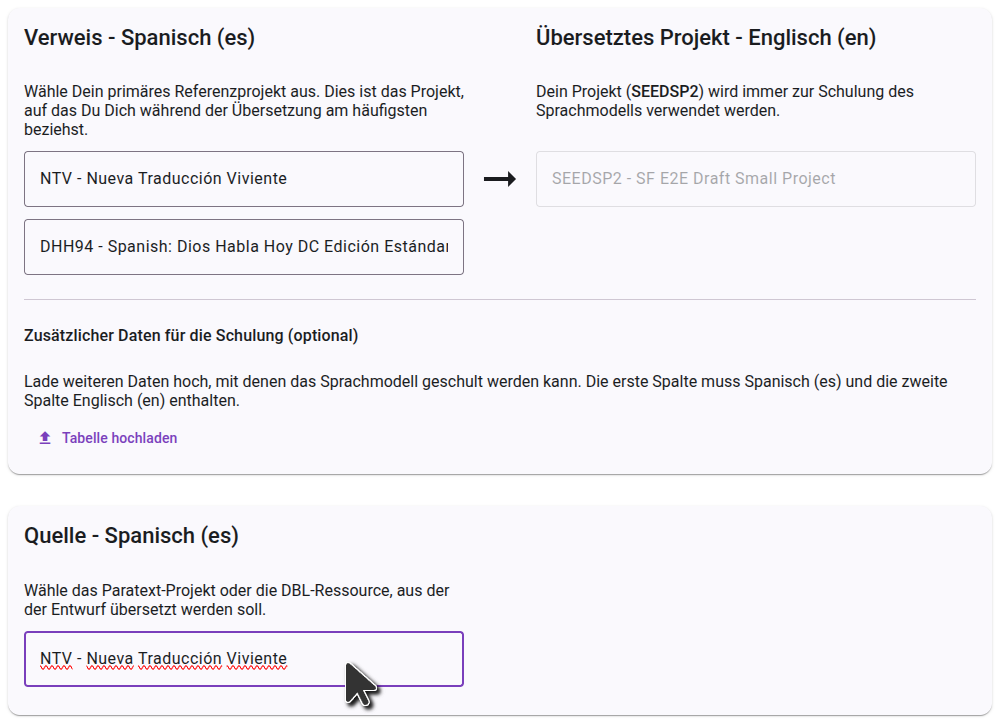
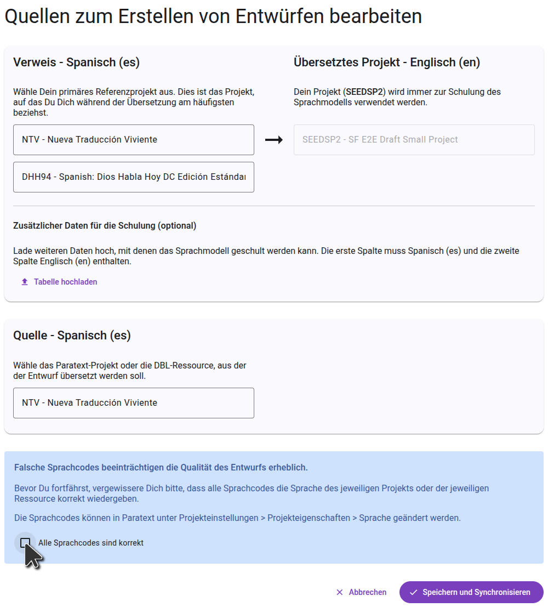

## Registrieren um einen Entwurf zu generieren {#c01e77600a3b440ead3f1b816837d614}

Um einen Entwurf in Scripture Forge zu regeistrieren, klicke auf die Schaltfläche "Entwurf generieren" im Hauptmenu. Klicke dann auf "Für Übersetzungsentwurf generieren anmelden" und fülle das Formular aus, das erscheint, um Deinem Projekt den Zugang zu ermöglichen. Rückübersetzungsprojekte sind standardmäßig aktiviert. Das Formular muss dafür nicht ausgefüllt werden.

:::note

Falls Du ein separates Paratext-Projekt eingerichtet hast, um generierte Entwürfe abzulegen, stelle sicher, dass Du Dich von Deinem Hauptübersetzungsprojekt aus registrierst. Registriere Dich nicht vom Ablageprojekt aus. Entwürfe können in einem anderen Projekt gespeichert werden, aber sie müssen von Deinem Hauptprojekt aus generiert werden, damit das Modell von Deiner vollständigen Übersetzungsarbeit lernen kann.

:::

Nachdem Du das Formular ausgefüllt hast, wird das Scripture Forge Onboarding-Team Deine Anfrage prüfen und die besten Einstellungen für Dein Projekt ermitteln. Du erhältst einen oder mehrere Entwürfe zur Durchsicht. Fall Du Dich dafür entscheidest, dass die Erstellung von Entwürfen für Dein Projekt das Richtige ist, wird das Team das Generieren von Entwürfen für Dein Projekt aktivieren und Dich durch den Prozess der Auswahl der besten Einstellungen führen.

## Konfigurieren des Entwurfs {#26e1244e99c0459bad277d7cff4417b8}

Sobald das Generieren von Entwürfen für Dein Projekt aktiviert ist, wird die Schaltfläche "Für das Generieren von Entwürfen anmelden" durch die Schaltfläche "Ausgangstexte konfigurieren" ersetzt. Klicke auf diese Schaltfläche, um die Projekte auszuwählen, die als Ausgangstext für Deinen Entwurf verwendet werden sollen.

### Auswahl der Referenzprojekte

Das Referenzprojekt wird für die Schulung des Sprachmodells verwendet. Normalerweise ist dies das Projekt, auf das Du Dich während der Übersetzung am häufigsten beziehst, aber in manchen Fällen kannst Du bessere Ergebnisse erzielen, wenn Du ein anderes Projekt verwendest. In einzelnen Projekten ist die Wahl eines zweiten Referenzprojekts möglicherweise sinnvoll. Ein häufiger Anwendungsfall ist es, Deine Rückübersetzung als zweites Referenzprojekt auszuwählen.

Jedes Projekt ist anders. Befolge daher die Anweisungen, die Du vom Onboarding-Team erhalten hast.

### Adding training data

Scripture Forge uses your project's completed translation to train the language model. To add more training data, upload a spreadsheet under **Additional training data (optional)**. Put a source-language sentence in the first column and its translation into your project's language in the second column of each row.

### Wähle das Ausgangsprojekt aus

Under **Source**, select the project you want the draft to be translated from. Dies kann ein Paratext-Projekt oder eine Ressource der Digitalen Bibelbibliothek sein. Gib den Anfang des Projektnamens (oder den Kurznamen des Projektes) ein und die Liste wird so gefiltert, dass Du nur die passenden Projekte siehst. Click on the project you want to use as a source.

### Die Sprachen bestätigen

Check that the language code shown for each project or resource matches the language of its text. You can change a project's language code in Paratext under **Project Settings > Project Properties > Language**.

Once the codes are correct, tick **All the language codes are correct** and click **Save & sync**. When the projects have finished syncing, click **Close** to return to the **Generate draft** page.

