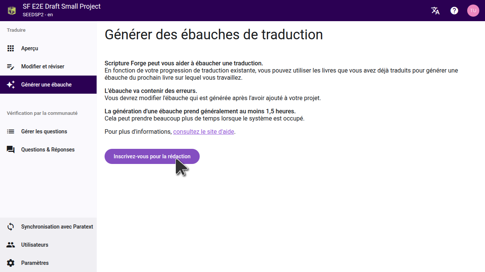
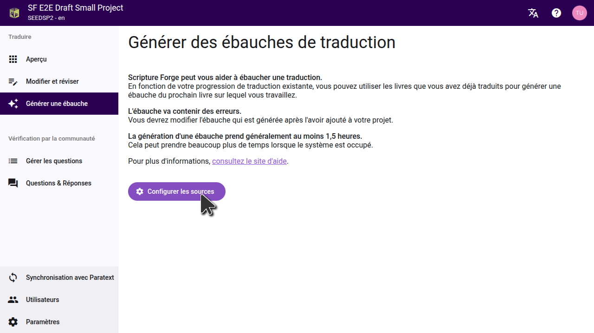
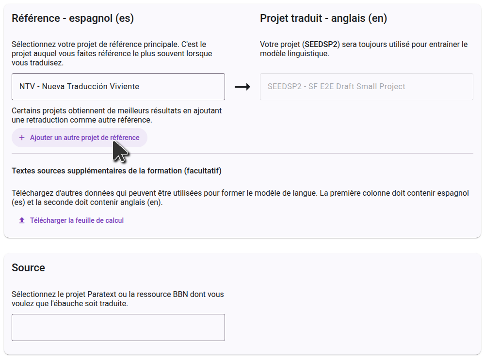
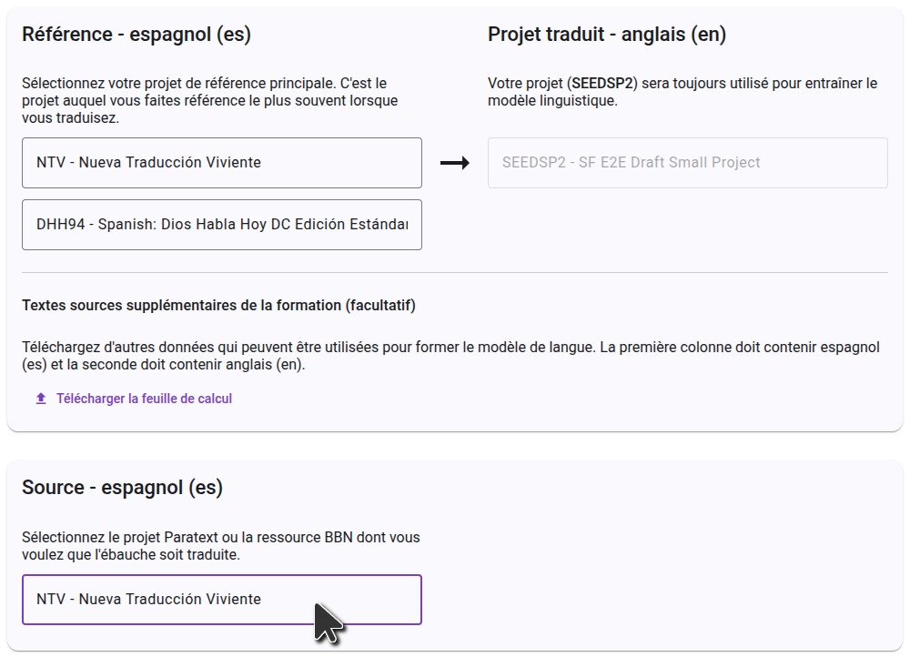
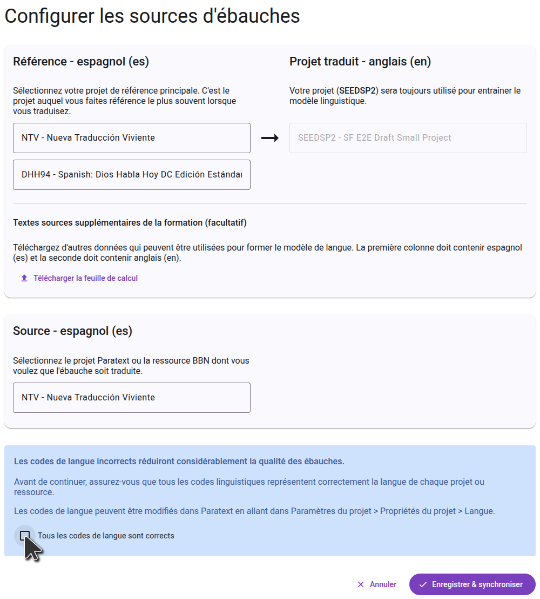

## Inscrivez-vous pour l'ébauche automatique. {#c01e77600a3b440ead3f1b816837d614}

Pour générer des ébauches dans la Forge des Écritures, cliquez sur le bouton « Générer une ébauche  » dans le menu principal. Cliquez ensuite sur le bouton "S'inscrire à l'ébauche", et remplissez le formulaire qui s'ouvre, pour avoir accès à votre projet. Les projets de retraduction sont activés par défaut et n'ont pas besoin de remplir le formulaire.

:::note

Si vous avez créé un projet Paratext séparé juste pour stocker les ébauches générées, assurez-vous de vous inscrire à partir de votre projet de traduction principal. Ne pas vous inscrire à partir du projet de stockage. Les ébauches peuvent être enregistrées dans un autre projet, mais elles doivent être générées à partir de votre projet principal afin que le modèle apprenne de votre travail de traduction terminé.

:::

Après avoir rempli le formulaire, L'équipe d'intégration de l'Écriture Forge examinera votre demande et travaillera pour trouver les meilleurs paramètres pour votre projet. Vous recevrez une ou plusieurs ébauches à examiner. Si vous décidez que la génération de l'ébauche est correcte pour votre projet, l'équipe activera la rédaction de votre projet et vous guidera dans le processus de sélection des paramètres qui ont été trouvés les meilleurs.

## Configuration d'ébauche  {#26e1244e99c0459bad277d7cff4417b8}

Une fois que la rédaction de votre projet a été activée, le bouton « S'inscrire pour ébaucher » sera remplacé par le bouton « Configurer les sources ». Cliquez sur ce bouton pour sélectionner les projets qui seront utilisés comme source de votre ébauche .

### Choix des projets de référence

Le projet de référence est utilisé pour la formation du modèle linguistique. Généralement, c'est le projet auquel vous faites référence le plus souvent lorsque vous traduisez, mais dans certains cas, vous pouvez obtenir de meilleurs résultats en utilisant un projet différent. Certains projets peuvent sélectionner un deuxième projet de référence. Un cas d'utilisation courant est de sélectionner votre traduction de retour comme deuxième projet de référence.

Chaque projet est différent, donc suivez les instructions que vous avez reçues de l'équipe d'intégration.

### Ajout des données de formation

Scripture Forge utilise la traduction finalisée de votre projet pour entraîner le modèle linguistique. Pour ajouter plus de données d'entraînement, téléchargez une feuille de calcul sous **Données d'entraînement supplémentaires (facultatives)**. Mettez une phrase de langue source dans la première colonne et sa traduction dans la langue de votre projet dans la deuxième colonne de chaque ligne.

### Choix du projet source

Dans la rubrique **Source**, sélectionnez le projet à partir duquel vous souhaitez que l'ébauche soit traduit. Ceci peut être un projet Paratext ou une ressource de bibliothèque biblique numérique. Commencez à taper le nom du projet (ou du nom abrégé du projet), et la liste filtrera pour ne montrer que les projets qui correspondent. Cliquez sur le projet que vous souhaitez utiliser comme source.

### Confirmation des langues

Vérifiez que le code de langue affiché pour chaque projet ou ressource correspond à la langue de son texte. Vous pouvez modifier le code de langue d'un projet dans Paratext sous **Paramètres du projet > Propriétés du projet > Langue**.

Une fois que les codes sont corrects, cochez **Tous les codes de langue sont corrects** et cliquez sur **Enregistrer et synchroniser**. Lorsque la synchronisation des projets est terminée, cliquez sur **Fermer** pour retourner à la page **Générer une ébauche**.

